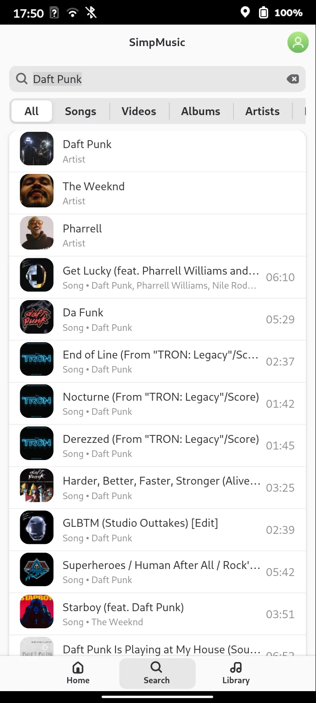
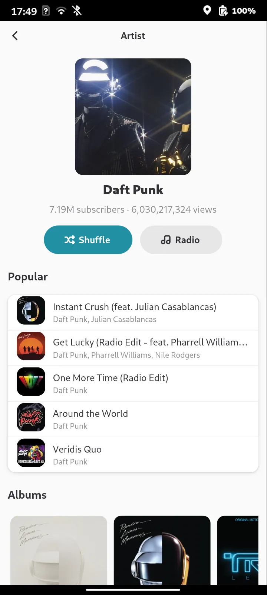
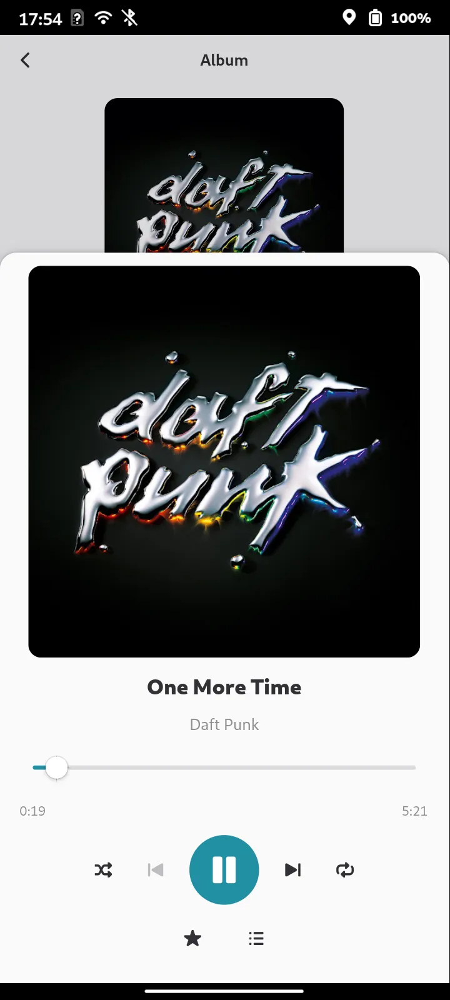
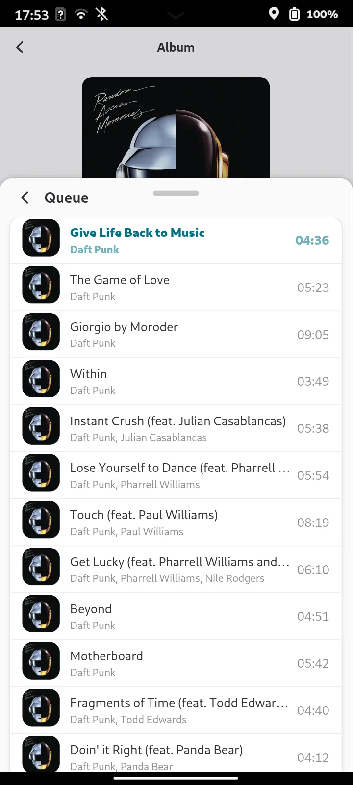
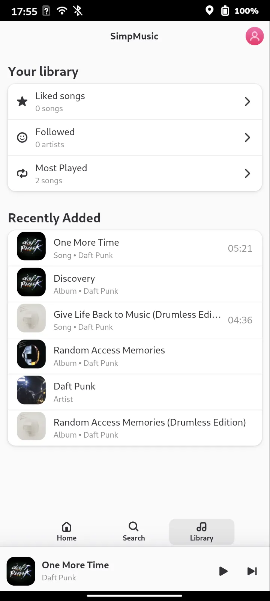
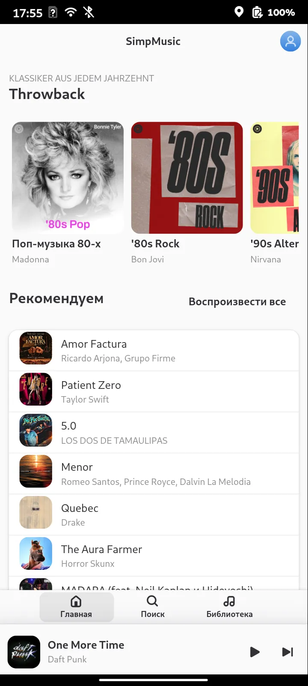

<div align="center">


# Musette

**An unofficial YouTube Music player for Linux phones**

Home feed · search · albums, artists, playlists · your library · background playback · lock screen controls

[](LICENSE)


</div>

Musette is a YouTube Music client with a native GTK4 and libadwaita interface for Phosh.
It is built on [SimpMusic](https://github.com/maxrave-dev/SimpMusic): the YouTube Music client,
streams, database and playback are SimpMusic's own code; the interface is new. Musette has its own
[APT](#from-the-apt-repository-recommended) and [Flatpak](#from-the-flatpak-repository)
repositories: add one of them once, and new versions arrive with your system updates.

Musette is independent of SimpMusic and Google.

## Supported systems

| Tier | Systems | Meaning |
|---|---|---|
| Supported | FuriOS on the FuriPhone FLX1s | Tested before each release; bugs block the release |
| May work | Mobian and other Debian-based Phosh systems on ARM64 (Debian 13 or newer) | Not verified; fixes are best effort |
| Not supported | PCs, other architectures and other mobile systems | No packages: Musette is built for ARM64 phones |

| | | | |
|:-:|:-:|:-:|:-:|
|  |  |  |  |
|  |  |  |  |

## Features

- Home: YouTube Music's shelves (quick picks, mixes, new releases, charts…), loaded page by page
- Search with suggestions, history and filters (songs, videos, albums, artists, playlists)
- Album, playlist and artist pages
- Library: liked songs, followed artists, most played, downloads, your playlists, the playlists
  and mixes of your YouTube account, saved albums and playlists, recently added
- Mini player and a Now Playing sheet: seek, shuffle, repeat, like, queue
- Likes sync to YouTube when you are signed in; signed out, they stay in your local favourites
- Playback controls and track information in Phosh and on the lock screen (MPRIS)
- Music keeps playing when the window is closed. Start Musette again to show the window, or
  choose **Quit** in the window menu to stop playback and exit
- Sign-in through Google's page, several accounts, sign-in with a cookie as a fallback
- The interface adapts to the window: a bottom tab bar on a phone, tabs in the header bar on a
  wider screen
- The interface comes in every language SimpMusic is translated into and follows the system
  locale; so does the region of YouTube's content until you choose one

## Install

Pick one of the two repositories. Both take every release from this project's
[releases page](https://github.com/x-vlad-x/musette/releases), and both are ARM64 only.

### From the APT repository (recommended)

The DEB is published in the signed APT repository [deb.xvlad.com](https://deb.xvlad.com), so
updates arrive with `apt upgrade`. On the phone:

```bash
sudo install -d -m 0755 /etc/apt/keyrings
curl -fsSL https://deb.xvlad.com/xvlad.gpg | sudo tee /etc/apt/keyrings/xvlad.gpg >/dev/null
curl -fsSL https://deb.xvlad.com/xvlad.sources | sudo tee /etc/apt/sources.list.d/xvlad.sources >/dev/null
sudo apt update
sudo apt install musette
```

Check the key before trusting it: `gpg --show-keys /etc/apt/keyrings/xvlad.gpg` must print the
fingerprint `3AEF 2C40 39D6 4C00 8CBA 5F03 2850 6009 1652 C539` (also published at
<https://deb.xvlad.com/fingerprint.txt>). The key is attached to this repository only through
`Signed-By` and is not trusted for any other source. The package itself is downloaded from the
GitHub releases of this project; apt checks it against the signed index.

The package brings its own Java runtime and uses GTK 4, libadwaita 1.7 or newer, WebKitGTK 6.0
and libmpv from the system: FuriOS 14, Debian 13 (trixie) or newer.

### From the Flatpak repository

Musette's signed Flatpak repository is [flatpak.xvlad.com](https://flatpak.xvlad.com). Open
[Musette.flatpakref](https://flatpak.xvlad.com/io.github.x_vlad_x.Musette.flatpakref) in GNOME
Software or another app store, or:

```bash
flatpak remote-add --user --if-not-exists flathub https://dl.flathub.org/repo/flathub.flatpakrepo
flatpak remote-add --user --if-not-exists xvlad https://flatpak.xvlad.com/xvlad.flatpakrepo
flatpak install --user xvlad io.github.x_vlad_x.Musette
```

The GNOME runtime comes from Flathub (the first command adds it if it isn't there yet), Musette
itself from the repository. The repository's key has the fingerprint
`535A 992E BE24 A42E 9782 8C66 2C44 13FC 2DFD DDCE`
(<https://flatpak.xvlad.com/fingerprint.txt>).

### From downloaded packages

Download a package from the [releases page](https://github.com/x-vlad-x/musette/releases) on
the phone, then, in that directory:

| System | Package | Install |
|---|---|---|
| FuriOS, Mobian and other Debian-based systems | `musette_<version>-1_arm64.deb` | `sudo apt install ./musette_*_arm64.deb` |
| Any Phosh system with Flatpak | `Musette-<version>-aarch64.flatpak` | `flatpak install --user ./Musette-*-aarch64.flatpak` |

To check the files first, compare them with `SHA256SUMS` from the same release
(`sha256sum -c --ignore-missing SHA256SUMS`). A downloaded package does not update by itself:
add one of the repositories above for that.

## Updating

With the APT repository, updates come with the rest of the system:

```bash
sudo apt update && sudo apt upgrade
```

With the Flatpak repository, through the app store or:

```bash
flatpak update --user
```

Installed a downloaded `.deb` before? Add the APT repository as above; `sudo apt update && sudo apt
upgrade` then brings the next versions. Installed a downloaded `.flatpak`? Move it to the
repository, keeping your account and library:
`flatpak install --user --reinstall xvlad io.github.x_vlad_x.Musette`.

Coming from the developer install made by `update-musette.sh`? Remove it first, so that its menu
entry does not hide the package's; your account, history and library stay where they are, and
the DEB uses them as they are:

```bash
./update-musette.sh --uninstall    # on the build machine; keeps the profile on the phone
```

## Removing

```bash
sudo apt remove musette                                # DEB
flatpak uninstall --user io.github.x_vlad_x.Musette    # Flatpak; add --delete-data to remove its data too
```

The DEB never touches your home directory. To delete your data too:
`rm -r ~/.local/share/musette ~/.cache/musette`. To remove the APT repository:
`sudo rm /etc/apt/sources.list.d/xvlad.sources /etc/apt/keyrings/xvlad.gpg && sudo apt update`.

## Where your data is

| | DEB | Flatpak |
|---|---|---|
| Account, history, library, settings | `~/.local/share/musette` | `~/.var/app/io.github.x_vlad_x.Musette/data/musette` |
| Thumbnails and the log (`run.log`) | `~/.cache/musette` | `~/.var/app/io.github.x_vlad_x.Musette/cache/musette` |

The DEB and the Flatpak keep separate profiles. On first start, the DEB copies the profile of the
earlier SimpMusic GTK install from `~/.local/share/simpmusic-gtk/home` if it has none yet.

## Known limitations

- ARM64 phones only; there are no packages for PCs.
- Lyrics, downloads for offline listening and SimpMusic's settings screens are not there yet.
- Signing in through Google's page in the Flatpak has not been checked on the phone yet. If the
  page stays empty, use sign-in with a cookie.
- Each package is about 220 MB: it carries a Java runtime and SimpMusic's libraries.

## Versions and support

Musette has its own version numbers, following [Semantic Versioning](https://semver.org); the
SimpMusic version it is built on is shown in **About Musette** and by `musette --version`.
Until 1.0.0, a minor release (0.2.0) may change behaviour. Only the latest release gets fixes.
Every release is listed in the [CHANGELOG](CHANGELOG.md).

## Building

The build machine is x86-64 Linux with Git, curl, JDK 21, the Android SDK, clang, lld,
llvm-objcopy, podman, Flatpak with flatpak-builder (or the `org.flatpak.Builder` Flatpak) and
qemu-user for ARM64 registered through binfmt_misc. Gradle fetches its JDK 25 toolchain.

```bash
tools/build-packages.sh            # out/packages: musette_<version>-1_arm64.deb, Musette-<version>-aarch64.flatpak
tools/build-packages.sh deb        # only the DEB
```

The JDK and the SDK are looked up in `JAVA_HOME_21` (default `~/Android/jdk-21`) and
`ANDROID_HOME` (default `~/Android/Sdk`). `tools/build-dist.sh` checks out the exact SimpMusic
and core commits in `upstream.env` into `SimpMusic/`, rejects patches that need an offset or
missing context, and builds the interface with Gradle. JVM bytecode is the same on every
architecture, so only small native parts are built for ARM64:

- `tools/build-runtime.sh` links a compact Java 25 runtime (Temurin, version and SHA-256 in
  `runtime.env`) from the x86-64 JDK and the ARM64 JMODs;
- `packaging/debian/build-deb.sh` builds the DEB in an ARM64 Debian 13 container and runs lintian;
- `packaging/flatpak/` builds libmpv, libplacebo and libass in the GNOME 51 SDK and packs the
  Flatpak.

`tools/third-party.py` keeps [THIRD-PARTY.md](THIRD-PARTY.md), the licences of the Java
libraries, up to date; `tools/prepare-release.py` and `tools/publish-release.sh` assemble and
publish a release with the complete corresponding source.

### Developer install over SSH

```bash
./update-musette.sh                # build and install in ~/.local/lib/musette on the phone
./update-musette.sh --check        # compare the phone installation with the pinned build
./update-musette.sh --build-only
./update-musette.sh --uninstall [--purge]
```

The SSH destination is taken from `PHONE` (default `furios`), e.g. `PHONE=furios@192.168.1.10`.

## How it works

The core (YouTube Music client, streams, local database, mpv playback) and the app logic
(SimpMusic's ViewModels) are the official SimpMusic code with small patches. The interface is
written in Kotlin with [java-gi](https://github.com/jwharm/java-gi).

- `gtk-ui/` — the interface (Gradle module `:gtkApp`): `AppWindow` (navigation, tabs), `HomePage`,
  `SearchPage`, `LibraryPage`, `DetailPages` (album, playlist, artist), `Player` (mini player, Now
  Playing, queue), `Account` (sign-in), `GtkDispatcher` (`Dispatchers.Main` on the GLib main loop),
  `Strings` (translations);
- `patches/` — build the GTK module with SimpMusic's translations (01), keep libmpv loaded
  privately to avoid crashes after sign-in (03), skip automatic lyrics and artwork requests (04),
  configure the MPRIS identity (05) and refresh the current rating after an account change (06);
- `sixel-stub/` — a stub `libsixel.so.1`: the system libmpv links libsixel, which aborted the JVM;
- `packaging/` — launcher, desktop entry, AppStream metadata, icons, the DEB and the Flatpak.

The interface strings are SimpMusic's own, except for a few in
`gtk-ui/src/jvmMain/resources/strings/`.

## Debugging

The app writes its log to `run.log` in its cache directory (see above).
The `MUSETTE_OPEN` variable accepts comma-separated commands such as `account`, `login`, `library`,
`mostplayed`, `nowplaying`, `queue`, `search:<query>`, `album:<browseId>`, `playalbum:<browseId>`
(also plays its first track), `artist:<channelId>`, `playlist:<id>`. For example:

```bash
MUSETTE_OPEN=playalbum:MPREb_K8qWMWVqXGi,nowplaying musette
```

## License

GNU General Public License v3.0, see [LICENSE](LICENSE) and [NOTICE](NOTICE). The libraries in the
packages are listed in [THIRD-PARTY.md](THIRD-PARTY.md). Each release carries the complete
corresponding source.

Musette uses the code and translations from the SimpMusic project. YouTube and YouTube Music are
trademarks of Google LLC.

---

### По-русски

Musette — неофициальный клиент YouTube Music для Linux-телефонов с родным интерфейсом GTK4 и
libadwaita для Phosh, построенный на SimpMusic: главная, поиск, альбомы, исполнители, плейлисты,
библиотека, очередь, фоновое воспроизведение и управление с экрана блокировки. Поддерживается
FuriOS на FuriPhone FLX1s; на других системах с Phosh на базе Debian для ARM64 может работать, но
это не проверено. Для ПК пакетов нет. Установка из репозиториев APT (`sudo apt install musette`)
или Flatpak, обновления приходят вместе с системными — выше, в разделах «Install», «Updating» и
«Removing». Интерфейс переведён на русский.
