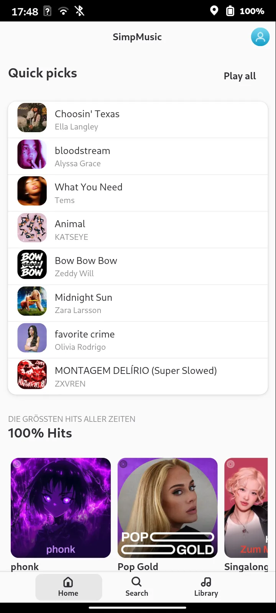
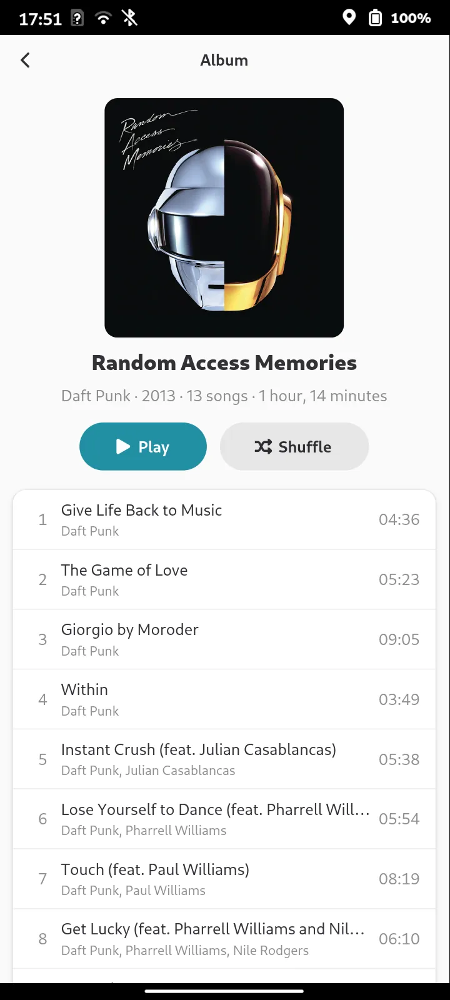

# Musette

Musette is an unofficial YouTube Music client built on [SimpMusic](https://github.com/maxrave-dev/SimpMusic).
It provides a native GTK4/libadwaita interface for Linux phones running Phosh.

## Supported systems

| Tier | Systems | Meaning |
|---|---|---|
| Supported | FuriOS on the FuriLabs FLX1s | Tested before each release. Bugs block releases. |
| May work | Other Debian-based Phosh systems on arm64, such as Mobian | Fixes are best effort. |
| Not supported | PCs, other architectures and other mobile systems | Builds target arm64 phones. |

| | | | |
|:-:|:-:|:-:|:-:|
|  |  |  |  |
|  |  |  |  |

The core (YouTube Music client, streams, local database, mpv playback) and the app logic (SimpMusic's
ViewModels) are the official SimpMusic code with small patches. The interface is new, written
in Kotlin with [java-gi](https://github.com/jwharm/java-gi), and adapts to the window: a bottom tab
bar on a phone, tabs in the header bar on a wider screen.

- Home: YouTube Music's shelves (quick picks, mixes, new releases, charts…), loaded page by page;
- search with suggestions, history and filters (songs, videos, albums, artists, playlists);
- album, playlist and artist pages;
- library: liked songs, followed artists, most played, downloads, your playlists, YouTube playlists
  and mixes of the signed-in account, saved albums and playlists, recently added;
- mini player and a Now Playing sheet: seek, shuffle, repeat, like, queue;
- YouTube sign-in through Google's page in a web view (WebKitGTK), several accounts, sign-in with a
  cookie as a fallback.

Lyrics, downloads and SimpMusic's settings screens are not there yet.

The interface comes in every language SimpMusic is translated into: its strings are SimpMusic's own,
except for a few in `gtk-ui/src/jvmMain/resources/strings/`. The language follows the system locale,
and so does the region of YouTube's content until one is chosen.

## Building and installing

Requirements on the build machine (x86_64 Linux): git, curl, ssh, JDK 21, the Android SDK (only
because SimpMusic's Gradle project needs it to configure), clang and lld. Gradle fetches the JDK 25
toolchain by itself. The phone must be reachable over SSH with key authentication.

```bash
./update-musette.sh                # build the pinned SimpMusic revision and install it on the phone
./update-musette.sh --check        # compare the phone installation with the pinned build
./update-musette.sh --build-only
./update-musette.sh --uninstall [--purge]
```

The SSH destination is taken from `PHONE` (default `furios`), e.g. `PHONE=furios@192.168.1.10`.
The JDK and the SDK are looked up in `JAVA_HOME_21` (default `~/Android/jdk-21`) and `ANDROID_HOME`
(default `~/Android/Sdk`).

The script checks out the exact SimpMusic and core commits in `upstream.env` into `SimpMusic/` and
rejects patches that need an offset or missing context. It builds the interface with Gradle and
packages it with its dependencies into `out/`. JVM bytecode is the same
on every architecture, so nothing is cross-compiled except a tiny native stub (see below). The first
build takes 5–10 minutes.

The developer install goes to `~/.local/lib/musette` with a private Temurin 25 runtime. Profiles live in
`${XDG_DATA_HOME:-$HOME/.local/share}/musette`. On first launch, Musette copies an existing profile
from `~/.local/share/simpmusic-gtk/home` if the new profile directory is absent. Thumbnails and logs
live in `${XDG_CACHE_HOME:-$HOME/.cache}/musette`. The installation runs as your user.
Runtime dependencies from the system: GTK 4, libadwaita, WebKitGTK 6.0 and libmpv.

## Project layout

- `gtk-ui/` — the interface (Gradle module `:gtkApp`): `AppWindow` (navigation, tabs), `HomePage`,
  `SearchPage`, `LibraryPage`, `DetailPages` (album, playlist, artist), `Player` (mini player, Now
  Playing, queue), `Account` (sign-in), `GtkDispatcher` (`Dispatchers.Main` on the GLib main loop),
  `Strings` (translations);
- `patches/` — build the GTK module with SimpMusic's translations (01), keep libmpv loaded
  privately to avoid crashes after sign-in (03), and skip automatic lyrics and artwork requests (04);
- `sixel-stub/` — a stub `libsixel.so.1`: the system libmpv links libsixel, which aborted the JVM;
- `packaging/` — launcher, desktop entry, AppStream metadata and icons.

## Debugging

The app writes its log to `${XDG_CACHE_HOME:-$HOME/.cache}/musette/run.log`.
The `MUSETTE_OPEN` variable accepts comma-separated commands such as `account`, `login`, `library`,
`mostplayed`, `nowplaying`, `queue`, `search:<query>`, `album:<browseId>`, `playalbum:<browseId>`
(also plays its first track), `artist:<channelId>`, `playlist:<id>`. For example:

```bash
MUSETTE_OPEN=playalbum:MPREb_K8qWMWVqXGi,nowplaying musette
```

## License

GNU General Public License v3.0, see [LICENSE](LICENSE) and [NOTICE](NOTICE).

Musette uses the code and translations from the SimpMusic project. Musette is independent of
SimpMusic and Google.
